# Terrain generator

[](https://github.com/fabio-t/terrain-generator/actions/workflows/ci.yml)
[](https://github.com/fabio-t/terrain-generator/releases/latest)

Procedural terrain generator written in Rust. It builds a fractal-noise
heightmap, shapes it into an island with noisy coastlines, carves it with
particle-based **hydraulic erosion**, and routes water over the result so
that **rivers follow the eroded valleys** and depressions become lakes.


It is usable three ways:

- as a **CLI** that renders maps to PNG,
- as a **Rust library** (`cargo` dependency),
- as an **Elixir library** via a Rustler NIF (`mix` dependency).

Generation is fully deterministic: the same seed and parameters always
produce the same terrain, from every entry point. A 512×512 map generates
in about half a second, 1024×1024 in about two.

## Pipeline

1. **Base heightmap** — fractal (fBm) OpenSimplex noise from the
   [`noise`](https://crates.io/crates/noise) crate.
2. **Island mask** — radial falloff, perturbed by a secondary noise field
   for natural coastlines.
3. **Hydraulic erosion** — droplet simulation (Beyer 2015): rain droplets
   roll downhill, pick up sediment and deposit it on flats, carving
   valleys and drainage networks.
4. **Hydrology** — priority-flood depression filling (Barnes et al. 2014)
   plus D8 flow accumulation; high-flow cells become rivers, filled
   depressions become lakes.

The output is not just an image: you get the heightmap, a flow/moisture
map, and river and lake masks as raw data for use in games or simulations.

## Installing the CLI

### Prebuilt binaries

Grab an archive for your platform from the
[latest release](https://github.com/fabio-t/terrain-generator/releases/latest):

| Platform | File |
|----------|------|
| Linux x86_64 (static, runs on any distro) | `terrain-generator-<tag>-x86_64-unknown-linux-musl.tar.gz` |
| macOS Apple Silicon | `terrain-generator-<tag>-aarch64-apple-darwin.tar.gz` |
| macOS Intel | `terrain-generator-<tag>-x86_64-apple-darwin.tar.gz` |
| Windows x86_64 | `terrain-generator-<tag>-x86_64-pc-windows-msvc.zip` |

Unpack it and run the `terrain-generator` binary inside — there are no
other files to install. `SHA256SUMS.txt` on the release page has the
checksums.

### With cargo

Requires a [Rust toolchain](https://rustup.rs) (1.85 or newer):

```sh
cargo install --git https://github.com/fabio-t/terrain-generator terrain-generator
```

### From a clone

```sh
git clone https://github.com/fabio-t/terrain-generator
cd terrain-generator
cargo run --release            # generates map0.png in the current directory
```

## Using the CLI

```sh
terrain-generator                          # one 512x512 map, seed 0 -> map0.png
terrain-generator -s 10 -n 5               # five maps, seeds 10..14
terrain-generator -W 1024 -H 1024          # bigger map
terrain-generator --rivers 0.02 --island 0.7 --droplets 2000000
terrain-generator --grey -o heightmaps/    # greyscale heightmaps into a directory
terrain-generator --help                   # all options
```

Every pipeline stage can be tuned (`--octaves`, `--frequency`, `--island`,
`--coast-noise`, `--droplets`, `--rivers`, `--sea-level`, ...) or disabled
(`--no-island`, `--no-erosion`, `--no-rivers`). The same seed with the
same options always reproduces the same map.

## What the options do

Every map below uses **seed 1** at 512×512; each row changes a single
option against the defaults. The same knobs exist under the same names in
the Rust API (`IslandParams`, `ErosionParams`, ...) and the Elixir API
(`:island`, `:coast_noise`, `:erosion`, `:rivers`, `:sea_level`, ...).

### Island shape — `--coast-noise`

How strongly noise perturbs the radial island falloff: `0` is a perfectly
round island, `1` (the default) carves bays, peninsulas and offshore
islets.

<table><tr>
<td align="center">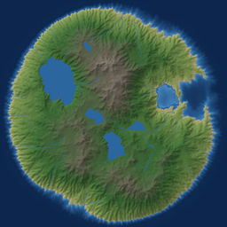<br><code>--coast-noise 0</code></td>
<td align="center">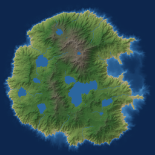<br><code>--coast-noise 0.5</code></td>
<td align="center"><br><code>--coast-noise 1</code> (default)</td>
</tr></table>

### Island size — `--island` / `--no-island`

Island diameter as a fraction of the shorter map dimension, or no island
mask at all (terrain runs to the borders — useful for tiling a larger
world out of maps).

<table><tr>
<td align="center">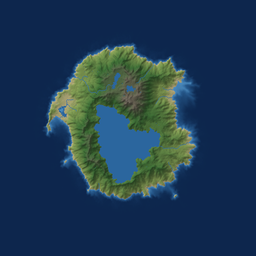<br><code>--island 0.7</code></td>
<td align="center"><br><code>--island 1.0</code> (default)</td>
<td align="center">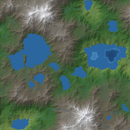<br><code>--no-island</code></td>
</tr></table>

### Erosion — `--no-erosion` / `--droplets`

Without erosion the raw fractal terrain is smooth and blobby. The default
simulates one droplet per cell; more droplets keep carving — valleys
deepen, sediment builds plains, coastlines erode.

<table><tr>
<td align="center">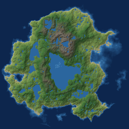<br><code>--no-erosion</code></td>
<td align="center"><br>default (262k droplets)</td>
<td align="center">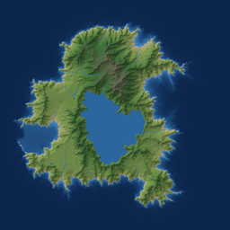<br><code>--droplets 1000000</code></td>
</tr></table>

### River density — `--rivers`

The approximate fraction of land covered by rivers (extracted from flow
accumulation, so they always follow the valleys). Shown as 1:1 crops so
the individual rivers are visible.

<table><tr>
<td align="center">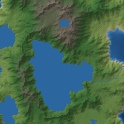<br><code>--rivers 0.003</code></td>
<td align="center">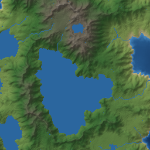<br><code>--rivers 0.01</code> (default)</td>
<td align="center">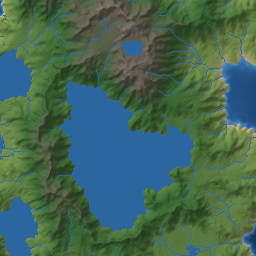<br><code>--rivers 0.04</code></td>
</tr></table>

### Sea level — `--sea-level`

Cells at or below this elevation are ocean. Raising it drowns the
lowlands and turns valley systems into fjord-like inlets.

<table><tr>
<td align="center">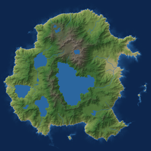<br><code>--sea-level 0.03</code></td>
<td align="center"><br><code>--sea-level 0.08</code> (default)</td>
<td align="center">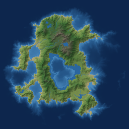<br><code>--sea-level 0.2</code></td>
</tr></table>

### Base noise — `--frequency` / `--octaves`

`--frequency` is the number of large features across the map (defaults to
`2.5`): lower gives one big landmass, higher gives busier, more broken
terrain. `--octaves` (default `8`) controls fine detail; fewer octaves
give smoother, softer relief.

<table><tr>
<td align="center">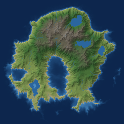<br><code>--frequency 1.5</code></td>
<td align="center">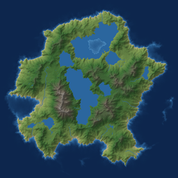<br><code>--frequency 4</code></td>
<td align="center">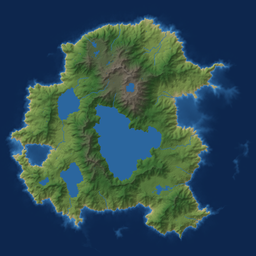<br><code>--octaves 4</code></td>
</tr></table>

### Output style — `--grey`

The shaded render is for looking at; the greyscale render is the raw
heightmap (black = 0, white = 1), ready to import into game engines and
other tools.

<table><tr>
<td align="center"><br>default (shaded)</td>
<td align="center">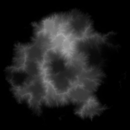<br><code>--grey</code></td>
</tr></table>

## Rust library

```toml
[dependencies]
# add features = ["png"] if you want PNG file output; without it the
# library's only dependency is the `noise` crate
terrain-generator = { git = "https://github.com/fabio-t/terrain-generator", default-features = false }
```

```rust
use terrain_generator::{RenderStyle, Terrain};

let terrain = Terrain::builder().size(512, 512).seed(42).generate();

let elevation = terrain.heightmap[(100, 100)]; // [0, 1]
let moisture  = terrain.flow_at(100, 100);     // [0, 1], from flow accumulation
let river     = terrain.is_river(100, 100);
let lake      = terrain.is_lake(100, 100);

// with the `png` feature:
terrain.save_png("map.png", RenderStyle::Shaded)?;
```

Full reference: [docs/rust_api.md](docs/rust_api.md), or `cargo doc --open`.

## Elixir library

The repository is also a Mix package wrapping the same Rust core through
[Rustler](https://hexdocs.pm/rustler). Erlang/OTP 24+, Elixir 1.15+ and a
Rust toolchain are required at compile time.

```elixir
def deps do
  [{:terrain_generator, github: "fabio-t/terrain-generator"}]
end
```

```elixir
{:ok, terrain} = TerrainGenerator.generate(width: 512, height: 512, seed: 42)
TerrainGenerator.Terrain.height_at(terrain, 100, 100)
#=> 0.53

:ok = TerrainGenerator.render_png("map.png", seed: 42)
```

Heightmap, flow, river and lake buffers are returned as plain binaries
(32-bit floats / bytes), cheap to pass around the BEAM. The NIF runs on a
dirty CPU scheduler, so generation never blocks your schedulers.

Full reference: [docs/elixir_api.md](docs/elixir_api.md), or `mix docs`.

## Development

```sh
cargo test                 # Rust unit + doc tests
cargo clippy --workspace   # lints
mix test                   # Elixir tests (needs Elixir + Rust)
```

CI runs formatting, clippy and both test suites on every push. Releases
are cut by pushing a tag: `v1.2.3` publishes a release with binaries for
Linux, macOS and Windows attached; a pre-release tag like `v1.2.3-rc1`
publishes a GitHub pre-release.

## License

Apache-2.0
