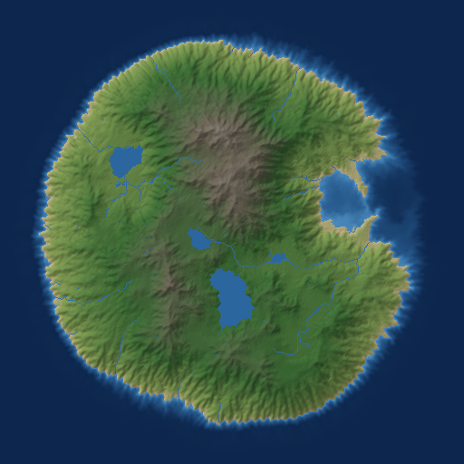

# Terrain generator

[](https://github.com/fabio-t/terrain-generator/releases/latest)

Procedural terrain generator written in Rust. It builds a fractal-noise
heightmap, shapes it into an island with noisy coastlines, carves it with
particle-based **hydraulic erosion**, and routes water over the result so
that **rivers follow the eroded valleys** and depressions become lakes.



It is usable three ways:

- as a **CLI** that renders maps to PNG,
- as a **Rust library** (`cargo` dependency),
- as an **Elixir library** via a Rustler NIF (`mix` dependency).

Generation is fully deterministic: the same seed and parameters always
produce the same terrain, from every entry point.

## Pipeline

1. **Base heightmap** — fractal (fBm) OpenSimplex noise from the
   [`noise`](https://crates.io/crates/noise) crate.
2. **Island mask** — radial falloff, perturbed by a secondary noise field
   for natural coastlines.
3. **Hydraulic erosion** — droplet simulation (Beyer 2015): rain droplets
   roll downhill, pick up sediment and deposit it on flats, carving
   valleys and drainage networks.
4. **Hydrology** — priority-flood depression filling (Barnes et al. 2014)
   plus D8 flow accumulation; high-flow cells become rivers, filled
   depressions become lakes.

The output is not just an image: you get the heightmap, a flow/moisture
map, and river and lake masks as raw data for use in games or simulations.

## CLI

```sh
cargo run --release                        # one 512x512 map, seed 0 -> map0.png
cargo run --release -- -s 10 -n 5          # seeds 10..14
cargo run --release -- -W 1024 -H 1024 --rivers 0.02 --grey
cargo run --release -- --help              # all options
```

Or install it: `cargo install --path .` then `terrain-generator ...`.

Every pipeline stage can be tuned (`--octaves`, `--island`, `--droplets`,
`--rivers`, `--sea-level`, ...) or disabled (`--no-island`,
`--no-erosion`, `--no-rivers`).

## Rust library

```toml
[dependencies]
terrain-generator = { git = "https://github.com/fabio-t/terrain-generator", default-features = false }
```

```rust
use terrain_generator::{RenderStyle, Terrain};

let terrain = Terrain::builder().size(512, 512).seed(42).generate();

terrain.save_png("map.png", RenderStyle::Shaded)?;

let elevation = terrain.height_at(100, 100); // [0, 1]
let river     = terrain.is_river(100, 100);
```

Full reference: [docs/rust_api.md](docs/rust_api.md), or `cargo doc --open`.

## Elixir library

The repository is also a Mix package wrapping the same Rust core through
[Rustler](https://hexdocs.pm/rustler). A Rust toolchain is required at
compile time.

```elixir
def deps do
  [{:terrain_generator, github: "fabio-t/terrain-generator"}]
end
```

```elixir
{:ok, terrain} = TerrainGenerator.generate(width: 512, height: 512, seed: 42)
TerrainGenerator.Terrain.height_at(terrain, 100, 100)
#=> 0.53

:ok = TerrainGenerator.render_png("map.png", seed: 42)
```

Heightmap, flow, river and lake buffers are returned as plain binaries
(32-bit floats / bytes), cheap to pass around the BEAM. The NIF runs on a
dirty CPU scheduler, so generation never blocks your schedulers.

Full reference: [docs/elixir_api.md](docs/elixir_api.md), or `mix docs`.

## Development

```sh
cargo test                 # Rust unit + doc tests
cargo clippy --workspace   # lints
mix test                   # Elixir tests (needs Elixir + Rust)
```

## License

Apache-2.0
